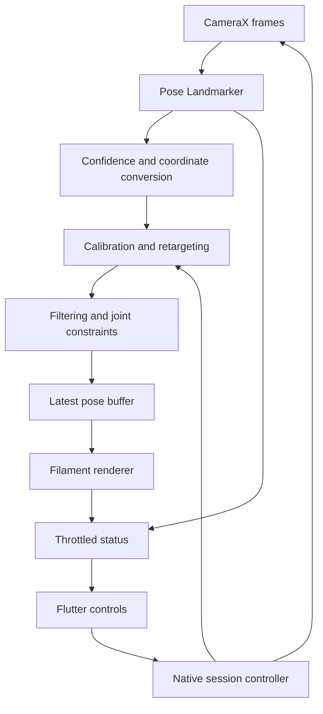
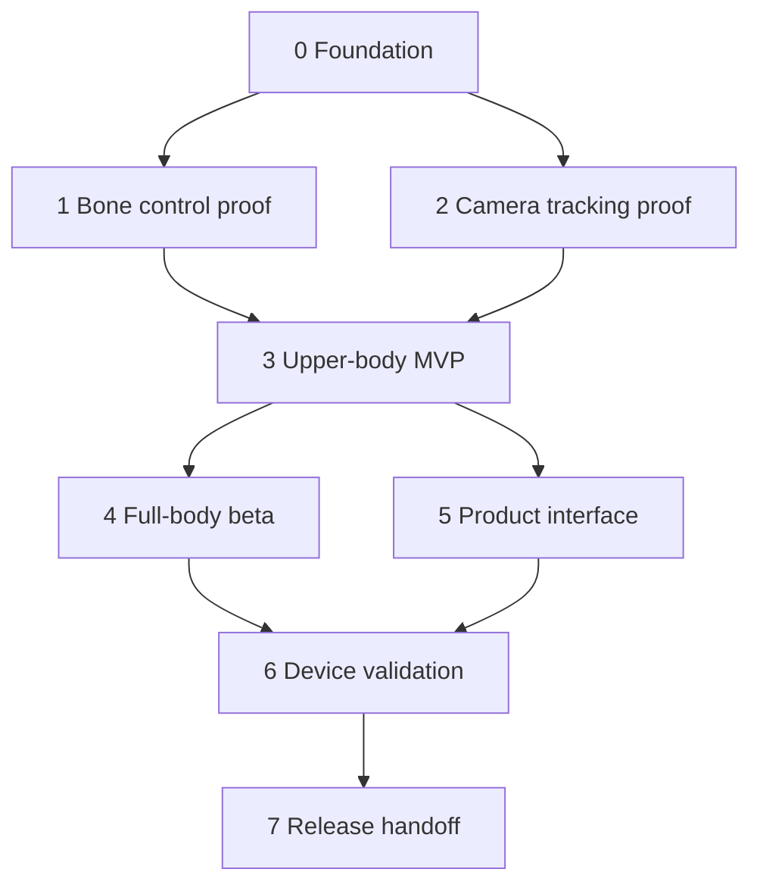
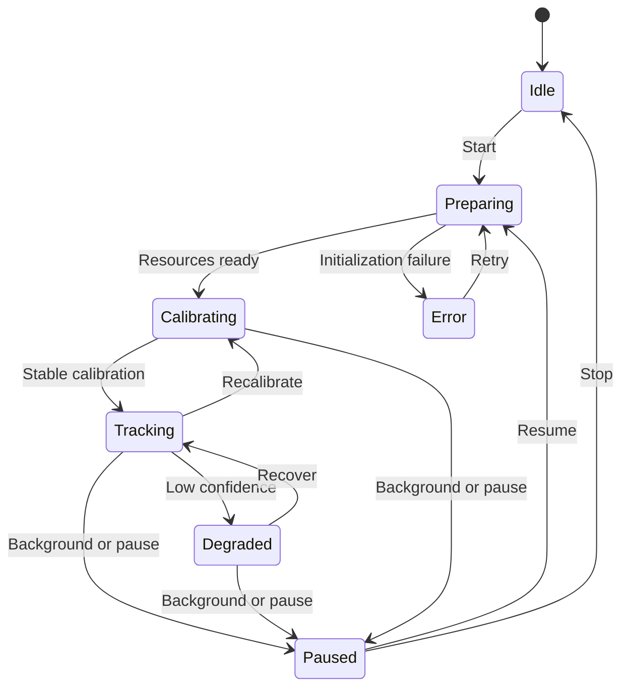

# Mimic: Android Character Motion Tracking

## Agent development specification · v1.0 · 24 October 2026

**Owner:** Ajay Jasper J  
**Status:** Planning specification; no implementation or device validation claimed.  
**Purpose:** Give an AI coding agent a complete, gated path to a Flutter Android application in which one rigged Mixamo character mimics one person through the phone camera.

## 1. Product outcome and boundaries

Deliver an installable Android APK with local camera tracking, a visible 3D character, calibration, tracking status, camera switching, and adjustable smoothing. The APK must work offline after installation with bundled assets. Flutter owns the interface; native Android owns the high-frequency tracking and rendering pipeline. Python is an optional desktop development tool, not a required runtime or server.

The initial release supports one approved humanoid rig and one person. Start with upper-body movement, then add full-body approximation. The character starts anchored at the scene origin. Do not describe estimated monocular depth as accurate room-scale position.

Not included in the initial release: exact professional motion capture, guaranteed 360-degree tracking, arbitrary character imports, finger articulation, facial expression animation, automatic motion export, multiple people, cloud accounts, or integration into Wondertail. This is a separate project unless the owner later requests integration.

### User journey

1. Open app and grant camera access with a clear explanation.
2. See camera framing guidance and a loaded character.
3. Stand where the required joints are visible; select upper-body or full-body mode.
4. Hold the illustrated calibration pose; calibration proceeds only with stable, confident landmarks.
5. Move and see the character respond; observe clear tracking status.
6. Recalibrate, switch camera, change smoothing, or pause.
7. Leave the screen: camera, inference, and rendering stop cleanly.

### Definition of initial success

A physical Android phone runs the APK offline, tracks one visible person, and makes the character's shoulders and elbows follow independently with correct sides, no exploding mesh, and no accumulating inference backlog. Full-body release requires the additional gates below. Building an APK alone is not acceptance.

## 2. Architecture decision

| Layer | Default implementation | Responsibility |
|---|---|---|
| Interface | Flutter / Dart | Setup, controls, guidance, settings, status |
| Camera | CameraX / Kotlin | Frame acquisition, orientation, lifecycle, backpressure |
| Tracking | MediaPipe Tasks Pose Landmarker / Kotlin | One-person landmarks and confidence |
| Retargeting | Kotlin pure-math module | Coordinates, calibration, joint rotations, filtering |
| Rendering | Filament + gltfio / native Android | GLB loading, skeleton transforms, skinning, scene |
| Flutter integration | Native view plus platform channels | Embed renderer; exchange commands and throttled status |
| Development tools | Python, optional | Inspect GLB, generate fixtures, replay landmarks, compare outputs |

This is a proposed architecture, not proof that every asset works. Phase 1 must demonstrate direct bone control with the selected Filament version. A maintained renderer wrapper is acceptable only if it exposes the required joint and skinning controls. A viewer that merely plays GLB animation clips is insufficient.

Keep camera frames and per-frame bone updates native. Do not serialize camera images through Dart. Send commands and low-rate diagnostics through channels. Start with a native composite view for camera/character display; verify Flutter overlays, z-order, surface recreation, and camera preview composition early.

### Runtime development chart



Only one component owns each resource. The session controller owns camera, detector, renderer, and their lifecycle. Render-thread updates consume the newest valid immutable pose snapshot; they must not block on inference.

## 3. Scope and priority

| Priority | Features |
|---|---|
| P0: feasibility | Render character, procedural elbow rotation, live skeleton overlay, offline operation |
| P1: upper-body MVP | Calibration, independent arms, approximate torso orientation, confidence fallback, smoothing, lifecycle |
| P2: full-body beta | Hips and legs, constrained knees, grounded display, limited foot contact handling |
| P3: release | Device profiles, diagnostics, thermal adaptation, accessibility, release package and documentation |
| Later | Face tracking, motion recording/export, multi-camera/depth support |

Owner-directed Linux 0.5.0 extension: import skinned Mixamo FBX/GLB characters and display them in the existing weighted-mesh preview and camera avatar. This is an implementation expansion; do not treat imported-rig compatibility as accepted until representative assets are checked against the supported format and retargeting limits in `docs/decisions.md`.

Do not add later features to compensate for unfinished P0/P1 behavior. A free app and open-source code do not automatically grant redistribution rights to every model or character asset.

## 4. Phases, dependencies, and effort

Estimates are focused developer days with AI assistance and device access. They are not elapsed-time guarantees. Start with approximately 20–35 days for the entire scoped release; a limited upper-body prototype can arrive earlier. Re-estimate after Phase 2. Asset problems, renderer integration, and device-specific failures can extend this substantially. The earlier conversational 1–3 day estimate applies only to a favorable, minimal demonstration.

| Phase | Work and deliverables | Exit gate | Effort |
|---|---|---|---|
| 0. Foundation | Repository, toolchain inventory, target phone, dependency/license register, asset inventory, risk log | Debug shell installs on target phone; versions recorded | 0.5–1 day |
| 1. Asset + rendering proof | Approved GLB, skeleton manifest, rest-pose transforms, native view, direct bone control | Elbow and shoulder move visibly without mesh corruption; neutral pose restores | 1–3 days |
| 2. Tracking proof | CameraX, MediaPipe live stream, overlay, rotation/mirror tests, timestamps and confidence | Live landmarks align with person; switch/background/resume and offline tests pass | 1–2 days |
| 3. Upper-body retargeting | Coordinate adapter, stable calibration, torso and arm solver, quaternion smoothing | Scripted arm tests pass on target phone; calibration neutral is stable | 3–5 days |
| 4. Full-body beta | Hip frame, legs, knee constraints, root policy, basic foot contact handling | Squat and stepping tests pass within declared limits; tracking loss is safe | 4–7 days |
| 5. Product integration | Setup, help, permissions, settings, diagnostics, state handling | Fresh-install user can calibrate and recover without developer intervention | 2–3 days |
| 6. Performance + reliability | Threading review, profiles, thermal session, resource recovery, second phone | Measured performance and lifecycle criteria met or deviations documented | 3–5 days |
| 7. Release handoff | Regression run, signed release if key available, notices, reports, reproducible build | Complete deliverables with truthful tested/untested labels | 1–2 days |

Product work may proceed after the upper-body gate, but the full-body release cannot skip Phase 4.

### Phase dependency chart



This diagram describes dependencies, not permission to spawn agents or a requirement for parallel execution.

## 5. Repository and deliverable structure

```text
mimic/
  AGENTS.md
  README.md
  CHANGELOG.md
  app/                         Flutter application
    lib/features/session/
    lib/features/settings/
    lib/platform/
    android/                   Native integration and Gradle configuration
    assets/characters/
    assets/tracking/
  native/                      Logical native modules; may live inside Android source sets
    camera/
    tracking/
    retargeting/
    rendering/
  tools/python/                Optional desktop scripts with pinned dependencies
  fixtures/                    Synthetic or explicitly consented pose data
  tests/                       Math and integration tests
  docs/
    architecture.md
    asset_manifest.json
    bone_mapping.json
    coordinate_conventions.md
    development_status.md
    decisions.md
    dependency_licenses.md
    device_test_report.md
    performance_report.md
    release_checklist.md
```

Avoid duplicating native code in both locations. Record actual paths in README. Keep raw camera footage out of Git. Commit lockfiles and dependency versions; do not use floating latest versions.

## 6. Character preparation contract

The owner must supply or authorize one rigged character before final validation. Use a clearly identified development asset while waiting; do not pretend it is the owner's asset.

1. Record source URL, acquisition date, author, license/terms, allowed use, and any redistribution restrictions.
2. Inspect FBX/GLB using Blender or a GLB inspection tool. Confirm actual skin, joints, weights, root hierarchy, textures, and bone names. A model need not contain animation clips to support live bone driving.
3. Convert FBX to GLB if needed. Preserve skin weights, bind transforms, hierarchy, and textures. Never blindly apply destructive rig transforms.
4. Record model units, forward/up axes, character height, rest pose, bone paths, parent indices, and local rest transforms.
5. Map semantic bones to actual names. Mixamo prefixes vary; do not hardcode a prefix as the only supported mapping.
6. Flag missing required bones before tracking starts. Retain neutral transforms for restoration.
7. Start with a modest asset budget, approximately 30k triangles or less and 1K textures where practical; benchmark before treating this as a hard requirement.

Required for upper body: hips/root reference, spine/chest reference, left/right upper arm and forearm. Full-body adds thighs, shins, and feet. Optional shoulders, hands, neck, and head require explicit handling. Body landmarks provide only approximate head orientation and do not provide facial expressions.

**Asset proof:** procedural rotations of each required joint, left/right identification, neutral restore, and ten load/unload cycles without a leak or crash. Stop and fix the asset/renderer before implementing pose mapping if this fails.

## 7. Frame and session contracts

Define typed equivalents of these logical records; examples describe data contracts, not ready-to-run SDK calls.

```text
PoseFrame v1
  sessionId: string
  sequence: integer
  capturedAtMonotonicMs: integer
  inferenceFinishedAtMonotonicMs: integer
  imageWidth, imageHeight: integer
  rotationDegrees: 0 | 90 | 180 | 270
  lensFacing: front | back
  previewMirrored: boolean
  imageLandmarks[33]: {x, y, z, visibility?, presence?}
  worldLandmarks[33]: {x, y, z, visibility?, presence?}
  trackingState: searching | tracking | partial | lost

RigPose v1
  sourceSequence: integer
  producedAtMonotonicMs: integer
  calibrationId: string
  localJointRotations: map<bonePath, quaternion[x,y,z,w]>
  rootOffsetMeters: vector3
  confidenceByJoint: map<bonePath, float>
```

Preserve nullable fields when the API does not expose a value; do not fabricate confidence. Reject NaN, infinity, zero-length vectors, invalid quaternions, old session IDs, and out-of-order frames. Enforce monotonically increasing MediaPipe input timestamps. Do not subtract clocks with unrelated origins.

Method-channel commands: initialize, start, pause, stop, calibrate, setCamera, setMode, setSmoothing, setMirrorBehavior, dispose. Commands return structured success/error results and are safe against repeated calls. Camera switches create a new tracking/calibration epoch and discard stale callbacks.

Status events at roughly 5–10 Hz: session state, calibration progress, confidence, inference FPS, render FPS, pose age, latency counters, thermal/profile changes, recoverable errors. Full-pose streaming to Dart is a diagnostic option, disabled by default.

## 8. Retargeting implementation specification

### Coordinate system

Choose one documented right-handed solver space with meters and explicit up/forward axes. Record the source-to-solver and solver-to-render transforms. MediaPipe world coordinates are model estimates centered at the hips, not measured absolute camera-space positions. Image coordinates are for preview overlay/framing; do not mix normalized image points with metric world points.

Front-camera preview mirroring and anatomical left/right are separate policies. The default mirrors the preview while preserving semantic body sides in the solver. Offer a deliberate mirror-movement mode. A reflection changes handedness; it is not interchangeable with a quaternion rotation. Test front/back cameras and display rotation independently.

### Calibration

Use an illustrated A- or T-pose matched to the solver's expectations. Collect approximately 1–2 seconds of stable frames with required joints visible; thresholds are tunable starting values. Reject bent/occluded arms, tiny person framing, or degenerate shoulder/hip axes. Estimate the torso basis, neutral bone corrections, and display scale. Store rig ID and camera/session configuration with calibration. Reset smoothing on successful recalibration and invalidate incompatible calibration on camera changes.

### Solve

1. Apply confidence checks and consistent source-coordinate conversion.
2. Construct an orthonormal torso frame from shoulders/hips; handle nearly parallel vectors without division by zero.
3. Derive limb segment directions from joint pairs. Use arm/leg bend planes to estimate secondary orientation only when reliable.
4. Compute desired global joint orientations using the documented rig-axis correction. Direction alone cannot determine bone twist: preserve a neutral twist or use a constrained estimate.
5. Convert desired global orientation to parent-local orientation. With active rotations and parent-first composition, use q_local = inverse(q_parent_global) * q_desired_global; verify the chosen library's multiplication convention with fixtures.
6. Apply the calibrated rest-pose correction in the tested order. Do not substitute a universal quaternion formula for model-specific bind-axis mapping.
7. Preserve rest translations and scales. Normalize all output quaternions and constrain implausible joint motion.
8. Smooth rotations with shortest-path quaternion interpolation and elapsed-time-based filtering. Resolve q versus -q sign equivalence. Higher smoothing adds latency; expose a useful bounded control.
9. On the render thread, apply local transforms to mapped joints, recompute skinning using the renderer's supported API, then render. Do not let clip playback overwrite live joint transforms.

### Confidence and loss policy

Starting tuning policy: hold a joint briefly (around 200 ms) after confidence loss, then blend it toward neutral over around 500 ms. Mark tracking lost after a sustained absence around one second. These are initial settings, not validated constants. Recover with a short blend to avoid snapping. Gate dependent joints as a chain; do not let an invalid shoulder produce a confident wrist.

### Full-body policy

Initially anchor root X/Z and keep character scale fixed. Approximate crouching through hip/leg pose rather than shrinking the mesh. Add basic ground-contact detection and constrained IK only after leg tracking is stable. Release contact when confidence drops or foot movement indicates a step. Foot locking can suppress sliding but can also create incorrect locks; document it as heuristic. Do not promise accurate walking through a room from hip-centered landmarks alone.

## 9. State, lifecycle, and privacy



Every active state must additionally support stop/dispose and fatal-error transitions. Serialize transitions; release image buffers even on exceptions. Handle permission denied, permanently denied, camera busy, absent model, invalid GLB, detector failure, surface loss, and low-memory conditions with useful recovery actions.

Camera permission is requested only when needed. Process frames locally and discard them after inference. Do not record, upload, or enable telemetry by default. Diagnostic pose recordings require deliberate user action, a delete option, and a clear destination. Verify offline startup with the tracking model and character packaged in the APK.

## 10. Performance and measurable quality

These are proposed acceptance targets, not existing measurements. Record exact phone model, SoC, RAM, Android version, build mode, tracking model, camera resolution, render settings, and test duration. Select one target phone in Phase 0; validate a second phone before claiming broader compatibility. If only one is available, mark the second-device gate pending.

| Metric | Initial target / method |
|---|---|
| Render rate | Median >=30 FPS over a 10-minute release session on target phone; report p95 frame time |
| Pose rate | Median >=15 processed poses/second in good conditions; report drops and thermal changes |
| Software pose age | p95 <=200 ms from frame timestamp to render consumption; report clock convention |
| Visible motion delay | Aim <=250 ms; measure separately with external high-frame-rate recording when available |
| Idle jitter | At most about 5 degrees standard deviation on selected major bone rotations during a 10-second still pose; report method |
| Resources | No sustained memory growth across 20 start/stop cycles; no camera held after stop |
| Reliability | No crash/ANR in a 30-minute session; safe lost-tracking recovery |
| Offline | Fresh launch and tracking work in airplane mode after installation |

Software pose age excludes some sensor/display latency; do not label it complete motion-to-photon latency. The angle jitter target describes stability, not anatomical accuracy. A low-confidence still pose must not pass by silently freezing the character.

Begin near 640x480 camera analysis resolution, a lightweight pose model, a simple scene, and bounded buffers. Use latest-frame backpressure, never an unbounded queue. Let render rate and inference rate differ. Evaluate CPU/GPU delegates on the actual phone; keep a tested fallback. Reduce inference frequency/resolution and rendering cost under thermal load. Record every tradeoff and repeat only affected checks.

## 11. Validation matrix

| Test | Expected behavior | Evidence |
|---|---|---|
| Neutral calibration | Character returns to expected neutral pose without inverted limbs | Screenshot + recorded settings |
| Left/right arm raise | Only intended arm follows; mirrored mode behaves as labelled | Short device capture or witnessed checklist |
| Elbow bends and hands forward | Forearms bend plausibly; no sudden twist flips | Replay fixture + device check |
| Torso lean | Torso follows without changing character scale | Device check |
| Squat | Knees and hips bend; mesh never shrinks | Device check, full-body gate |
| Step and lift foot | Correct leg lifts; ground behavior stays bounded | Device check, known limitations |
| Cross arms / hide one limb | Confidence falls and fallback activates safely | Status log + device check |
| Turn sideways / away | No promise of precision; degraded tracking is indicated | Limitation report |
| Leave / re-enter frame | Neutral fallback and smooth reacquisition | Timed session log |
| Camera switch / orientation | Overlay and avatar sides remain correct; stale pose discarded | Front/back matrix |
| Permission denied / camera busy | Clear recovery; no crash or stuck session | Integration test |
| Background / resume x20 | Resources release and tracking restarts correctly | Device log |
| Offline launch | Tracking and model load without server access | Airplane-mode check |
| 10/30-minute runs | Performance and stability targets assessed honestly | Performance report |

Use unit tests where they catch substantive defects: basis orthogonality, quaternion normalization/sign continuity, parent-local conversion, handedness adapters, degenerate inputs, timestamp ordering, and session cancellation. Add synthetic landmarks with known movement to distinguish solver defects from tracker errors. Test the rig adapter with known rest transforms.

Do not call screenshots or landmark confidence an accuracy benchmark. Measuring joint-angle accuracy needs an independent reference and a declared protocol. Report visual acceptance, stability, and tracking coverage separately. Body tracking confidence scores are not percentage accuracy.

## 12. Open-source resources and licensing register

Checked against primary project documentation on 24 October 2026. Pin versions and recheck terms when acquiring assets/dependencies. Source availability alone does not establish unrestricted reuse.

| Resource | Role | Agent instruction |
|---|---|---|
| [MediaPipe Android guide](https://ai.google.dev/edge/mediapipe/solutions/vision/pose_landmarker/android) | Pose inference API | Follow current live-stream API, callback/threading and timestamp requirements |
| [MediaPipe Android example](https://github.com/google-ai-edge/mediapipe-samples/tree/main/examples/pose_landmarker/android) | Camera/tracking reference | Start from relevant patterns; preserve applicable notices |
| [Filament](https://github.com/google/filament) | Renderer and gltfio | Check exact pinned release and Android skinning API |
| [Filament Animator source](https://github.com/google/filament/blob/main/android/gltfio-android/src/main/java/com/google/android/filament/gltfio/Animator.java) | Transform/skinning behavior | Confirm update order and supported joint manipulation in Phase 1 |
| [Flutter platform views](https://docs.flutter.dev/platform-integration/android/platform-views) | Native renderer embedding | Test surface and overlay behavior on device |
| [Flutter platform channels](https://docs.flutter.dev/platform-integration/platform-channels) | Control/status bridge | Respect threading rules; keep bulk frames native |
| [KalidoKit](https://github.com/yeemachine/kalidokit) | Retargeting math reference | Repository marks it deprecated; avoid a new runtime dependency. Do not assume MediaPipe already supplies complete Mixamo retargeting |
| [XR Animator](https://github.com/ButzYung/SystemAnimatorOnline) | Behavior/reference implementation | Read its own licensing terms before copying any code |
| [Mixamo](https://www.mixamo.com/) | Rigged development character | Character service/assets are not automatically open source; verify applicable Adobe terms and redistribution conditions |

For each shipped component record name, version/commit, license file, required notices, source, and whether code, model weights, or character assets are involved. Do not equate a code license with model/asset licensing. Do not scrape or bypass accounts to obtain assets. Prefer an explicitly redistributable placeholder for public example repositories.

## 13. AI agent operating instructions

Use this section as the project's AGENTS.md starting point.

1. Read this specification, repository instructions, development_status.md, and decisions.md before edits. Inspect existing code before creating replacements.
2. Start at the first incomplete phase. Record assumptions; resolve routine implementation choices autonomously. Ask only for genuinely blocking inputs such as the target asset, physical-device access, or a release signing key.
3. Maintain one current task, its exit gate, and evidence. Do not mark completion solely because code compiled, a tool returned success, or a screenshot looks plausible.
4. Verify external APIs against primary documentation for the exact pinned versions. Do not invent Flutter plugins, native bone APIs, model capabilities, benchmark results, or downloaded assets.
5. Implement the smallest vertical slice first: installed app -> visible character -> procedural bone motion -> camera skeleton -> one tracked arm -> both arms -> torso -> legs.
6. Maintain one coordinate-conversion layer and one rig mapping. Never fix an unexplained axis error by scattering sign flips through the solver.
7. Preserve existing work. Keep changes scoped, reversible, and reviewable. Do not rewrite architecture or upgrade unrelated dependencies without a concrete need and a documented decision.
8. Run relevant formatting, static analysis, unit and integration checks for changed code. Record commands, outcomes, and environment. Never report unrun checks as passing.
9. If Android SDK, camera, GPU, physical device, network, or signing is unavailable, complete independent work and explicitly mark affected gates BLOCKED or NOT RUN. An emulator is useful for interface tests but does not establish phone-camera or thermal performance.
10. Keep a status entry after each meaningful milestone. Include changed files, validation, unresolved defects, and the next exact task so another agent can resume.
11. After two materially different failed attempts at a blocker, write a minimal reproduction, root-cause hypotheses, and a bounded next experiment. Continue independent work; do not hide the failure behind a dependency swap.
12. Do not add network upload, user accounts, paid services, asset purchases, publishing, or unrelated game integration without an owner request.
13. Protect signing keys and credentials. Do not commit secrets. If no release key is provided, deliver a clearly labelled debug APK and unsigned/reproducible release instructions; never claim it is signed for distribution.
14. Do not claim a success percentage. Give tested outcomes, remaining gates, and known limits.

### Session handoff template

```text
Date / agent:
Current phase and task ID:
Status: TODO | IN_PROGRESS | BLOCKED | VERIFIED
Changes and relevant paths:
Commands run and results:
Device evidence / NOT RUN reason:
Open defects and severity:
Decisions and assumptions:
Next exact action:
```

### Initial ordered task backlog

| ID | Task | Depends on |
|---|---|---|
| M00 | Inventory Flutter, Dart, JDK, Gradle, Android SDK, adb and device access | None |
| M01 | Scaffold separate app and verify installation | M00 |
| M02 | Acquire permitted character and produce skeleton manifest | M00 |
| M03 | Embed renderer, load GLB, directly rotate one elbow, restore rest pose | M01, M02 |
| M04 | Implement camera permission, CameraX and lifecycle | M01 |
| M05 | Add bundled pose model and aligned landmark overlay | M04 |
| M06 | Implement coordinate adapter and synthetic pose fixtures | M02, M05 |
| M07 | Implement calibration and first arm retargeting | M03, M06 |
| M08 | Add second arm, torso, filtering and loss recovery | M07 |
| M09 | Pass upper-body gate and update estimate | M08 |
| M10 | Add hips, legs, grounded display and constrained contact handling | M09 |
| M11 | Finish setup, settings, errors and diagnostics | M09 |
| M12 | Measure target-device performance and fix major defects | M10, M11 |
| M13 | Run second-device regression or mark unsupported claims pending | M12 |
| M14 | Build deliverables and complete release checklist | M13 |

## 14. Release acceptance and handoff

Ship only when the declared scope has passed its relevant gates. A scoped upper-body MVP can be delivered before full-body work if clearly labelled.

- [ ] Source repository includes pinned dependencies, build instructions, model/asset preparation, coordinate conventions, rig mapping and applicable notices.
- [ ] APK type, application version, build commit and SHA-256 are recorded.
- [ ] Camera and character work offline; permission and lifecycle tests pass.
- [ ] Upper-body movement is demonstrated on a named physical phone.
- [ ] Full-body claims are supported by Phase 4 evidence, or explicitly excluded from the release.
- [ ] Performance report contains measured results and conditions, including failed targets.
- [ ] Release has no known crash, corrupt-mesh, camera-leak, or unbounded-queue defect.
- [ ] Remaining jitter, occlusion, depth, turning, root-motion and foot-contact limits are documented.
- [ ] A short owner guide explains framing, calibration, lighting, smoothing and recovery.
- [ ] A device demonstration is included when available, with recording consent; no private footage is committed.
- [ ] Another developer can reproduce the build from the documented environment.

**First instruction to the implementing agent:** Read this entire specification and local repository instructions. Create the status and decision records, inventory the environment, then execute M00–M03. Prove direct bone control before building full tracking or polished screens. Continue through the ordered gates, reporting evidence and blockers honestly.
